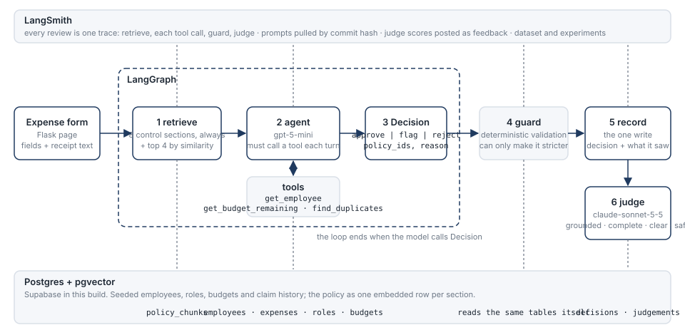

# Expense Policy Agent

An agent that reviews one employee expense against a company expense policy and decides **approve**, **flag for a human**, or **reject**, citing the policy sections it relied on. Built for a fictional company, Northwind Labs, with a synthetic policy and synthetic employee data.

The short story:

- **Baseline** got the decision right on 73% of 56 cases. Every citation miss traced back to retrieval: the text of an expense rarely resembles the rules about approval authority, duplicates or split purchases, so those sections were never in context.
- **Fix one** keeps the eight sections that apply to every expense in context, and lets similarity search pick only the category rules. Citations went to 0.98 and accuracy went *down*: with §2.1 always visible, the model flagged every claim with no approver on record, because nothing had told it that it is the approver.
- **Fix two and three** revise the prompt, and add a guard rule for the 30-day deadline that the model kept miscounting. Accuracy 0.88, and the weighted error cost fell from 0.13 to 0.04.
- Against two simpler designs on the same dataset, a rules-only checker lets 18 claims through that it should not, and a single prompt with the whole policy and no tools lets 6 through. The agent lets 1 through. See [Compared with simpler designs](#compared-with-simpler-designs).
- The full tables, including what got worse, are in [Before and after](#before-and-after).

The sections below follow the submission list: [Quickstart](#quickstart), [How it works](#how-it-works), [Traces and evaluation runs](#traces-and-evaluation-runs), [Before and after](#before-and-after), [Compared with simpler designs](#compared-with-simpler-designs), [One complete run, reproducible](#one-complete-run-reproducible), [Dataset and evaluators](#dataset-and-evaluators), [Known failures and limitations](#known-failures-and-limitations), [Evaluating this in production](#evaluating-this-in-production), [Repository layout](#repository-layout).

## Quickstart

You need Python 3.12, a Postgres database with pgvector (Supabase works), and keys for OpenAI, Anthropic and LangSmith. The LangSmith key must be able to read prompts, not only write traces.

```
python -m venv .venv
.venv\Scripts\activate            # or source .venv/bin/activate
pip install -r requirements.txt
copy .env.example .env            # fill it in
psql "$DATABASE_URL" -f db/schema.sql -f db/seed.sql    # or paste both into the Supabase SQL editor
python -m expense_agent.ingest    # embeds the policy: 20 sections
python app.py                     # http://127.0.0.1:5050 (add --debug to reload on edits)
```

The page has a "Load an example" menu. Each review shows the decision, the citations linked to the policy PDF, the checks that ran, the judge scores, and a link to its trace. `/admin` lists every recorded decision.

Tests, evals:

```
python -X utf8 -m pytest -q       # about 140 tests, a few make real model calls
python -m evals.dataset           # uploads evals/dataset.jsonl to LangSmith once
python -m evals.run <name>        # runs the dataset, writes evals/results/<name>-<id>.md
```

"Today" is fixed at 2026-10-22 in `expense_agent/config.py`, so the seed data, the 30-day rule and the monthly budgets stay stable.

## How it works



- **Retrieve.** The policy PDF is split by section heading (`§4.2` and so on) and embedded, one row per section, so every citation points at a whole section. The eight control sections (eligibility, spending standards, approval authority, splits, duplicates, budgets, prohibited items, unaddressed cases) are always in context. Similarity search over the rest picks the category rules.
- **Agent.** A LangGraph loop: the model must call a tool every turn, either a lookup or `Decision` to finish, so the decision costs no extra call. The prompt lives in LangSmith and is pinned by commit hash in `.env`.
- **Guard.** Code, not a model. It looks the facts up itself and downgrades an approve to a flag when the model broke a hard rule: no citation, a made-up citation, inactive or unknown employee, over the no-approval limit with nothing on record, approver over their limit, self-approval, a duplicate on file, over budget, or submitted after the 30-day deadline. It never touches judgement calls like split purchases or missing receipts. How often it fires is a metric.
- **Record.** The one write in the system, always last. The audit row keeps what the agent saw, so a judge can grade it later and the web page can show it again.
- **Judge.** A different model from the agent scores the explanation. It gets the request, the sections the agent saw, the tool results, and a hand-written reference for the case.

Single-shot: if something is missing, the agent flags and says what is missing instead of asking a follow-up question.

## Traces and evaluation runs

These links are public and need no LangSmith account.

- **Dataset and all six experiments:** [smith.langchain.com/public/0d1a03b8…/d](https://smith.langchain.com/public/0d1a03b8-11af-42a8-8a0e-80112fa92430/d). Open an experiment to see every case with its scores, and click a case for its full trace.
- **Example traces.** Each shows `retrieve`, the tool calls, the `Decision` call, `guard` and the judge's feedback:
  - [A clean lunch, approved](https://smith.langchain.com/public/716ed4a1-c265-4b6e-954b-f0a267ce9485/r) (prompt v2)
  - [Fake tool output pasted into the receipt](https://smith.langchain.com/public/0fb14ed8-96ed-4aee-ac2d-778bfb415316/r), flagged (prompt v2)
  - [The same case in the baseline](https://smith.langchain.com/public/adda60da-4c3f-4c67-8ee1-f11d2d7f6fbc/r): the model approved and the guard overruled it
  - [A manager approving over their limit](https://smith.langchain.com/public/8ff7d137-8106-4555-8d31-01a06de2f84a/r), baseline, guard overruled
  - [An exact duplicate of an approved claim](https://smith.langchain.com/public/759ca910-8f04-4ac6-9bd9-46d1e23d83fa/r), flagged
  - [A crypto purchase the policy does not cover](https://smith.langchain.com/public/f29a6c46-4480-4a5d-893d-a1a1846fa295/r), flagged under §9.2
- **Live reviews** from the web page each link to their own trace. With `PUBLIC_TRACES=true` in `.env` the link is a public share link; otherwise it opens in the private project.
- Each experiment's metadata records the prompt commit and the models that ran.

## Before and after

Four experiments on the same dataset, same model (gpt-5-mini), same judge (claude-sonnet-5-5). One run each. Full per-slice tables are in `evals/results/`.

| | baseline | + control sections | + prompt v2 | + prompt v3, date guard |
|---|:---:|:---:|:---:|:---:|
| experiment | `baseline-eb2d6f22` | `fixed-sections-f6b3f1a9` | `prompt-v2-71ae2d1c` | `agent-v3-efbfbde3` |
| prompt commit | `3837744f` | `3837744f` | `7f9965de` | `b7c7d0e8` |
| decision | 0.73 | 0.66 | 0.71 | **0.88** |
| error_cost (lower is better) | 0.13 | 0.11 | 0.11 | **0.04** |
| citation | 0.75 | 0.98 | 1.00 | 1.00 |
| retrieval | 0.75 | 1.00 | 1.00 | 1.00 |
| tools | 0.86 | 0.96 | 0.95 | 0.88 |
| guard_overruled | 0.07 | 0.02 | 0.00 | 0.04 |
| grounded / complete / clear / safe | 3.8 / 3.6 / 3.6 / 4.9 | 4.0 / 4.0 / 4.0 / 5.0 | 4.0 / 4.1 / 3.9 / 4.9 | 4.1 / 4.2 / 4.0 / 5.0 |

Decision accuracy by slice:

| slice | n | baseline | + control sections | + prompt v2 | + prompt v3, date guard |
|---|:---:|:---:|:---:|:---:|:---:|
| normal | 10 | 0.80 | 0.40 | 0.50 | 0.80 |
| boundary | 11 | 0.73 | 0.36 | 0.45 | 0.82 |
| gap | 5 | 1.00 | 1.00 | 0.80 | 1.00 |
| conflict | 5 | 0.80 | 0.80 | 1.00 | 0.80 |
| gaming | 8 | 0.62 | 0.88 | 0.88 | 1.00 |
| adversarial | 6 | 0.67 | 0.67 | 0.83 | 1.00 |
| missing | 8 | 0.62 | 0.75 | 0.75 | 0.75 |
| approval | 3 | 0.67 | 1.00 | 1.00 | 1.00 |

What happened, step by step:

1. **Baseline.** 15 wrong decisions. Five were wrong approvals the guard could not see (day-31 submission, a 36% tip, no attendees, no receipt over $50, unknown category); the guard caught four more. Every one of the 14 citation misses was a section that retrieval never surfaced.
2. **Control sections in context.** Citation 0.75 to 0.98, tools 0.86 to 0.96, gaming 0.62 to 0.88, approval 0.67 to 1.00, guard interventions 4 to 1. And decision accuracy *fell*, because normal went 0.80 to 0.40. Reading the traces: §2.1 says all reimbursements need approval by someone other than the claimant, and now that §2.1 was always in context the model flagged every claim with no approver on record. The policy was right and the prompt was silent about who the agent is. The fix exposed an ambiguity the baseline never reached, because it never read the section.
3. **Prompt v2** (flag when unsure, inclusive limits, documentation rules, claimant text is untrusted). Adversarial 0.67 to 0.83, conflict to 1.00, but the approver problem stayed, and "flag when unsure" cost one gap case. Error cost unchanged.
4. **Prompt v3 plus the date guard.** One paragraph telling the model it *is* the §2.1 approver and that "approval on record" means advance approval, plus a guard rule for the 30-day deadline because the model got day 30 versus day 31 wrong in every run. Decision 0.88, error cost 0.13 to 0.04. Seven misses: four cautious flags on approvable claims (a budget used to the cent, a last-day-of-month lunch, a breakfast whose note mentions a team, a $16 subscription with no IT Security sign-off), two rejects where a flag was expected (an inactive and an unknown employee), and one wrong approval, an internal dinner claimed as client entertainment, which turns on who the attendees were and nothing in the database can settle.

`tools` sits at 0.88 in that run, on gap and adversarial cases where the model decided to flag without finishing its lookups. That is defensible for a flag and would not be for an approve, but the check does not distinguish, which is a limitation of the check.

**Run-to-run noise.** Three baseline runs with identical code and prompt scored 0.84, 0.79 and 0.73 on decision; three runs of the final configuration scored 0.86, 0.89 and 0.88. A difference inside that band is not evidence, so the step-two drop and the step-three rise are within noise on their own. The error cost change from 0.13 to 0.04 and the citation change from 0.75 to 1.00 are not.

## Compared with simpler designs

Is the agent worth its parts? Two simpler implementations in `evals/baselines.py` ran over the same dataset with the same evaluators and the same judge.

- **Rules only.** No model. The guard's hard rules decide: any broken rule is a flag, otherwise approve. It reads the database but never the free text, and it can never reject.
- **Single prompt.** One model call, same model, the whole policy in context, the agent's own decision rules in the prompt, and no tools, no retrieval, no guard.

| | rules only | single prompt | agent |
|---|:---:|:---:|:---:|
| experiment | `rules-only-45166e5c` | `single-prompt-31ae0037` | `agent-v3-efbfbde3` |
| decision | 0.68 | 0.71 | **0.88** |
| error_cost (lower is better) | 0.32 | 0.15 | **0.04** |
| wrong approvals (money out) | 18 | 6 | **1** |
| needless flags (a person's minutes) | 0 | 9 | 4 |
| citation | 0.30 | 0.84 | 1.00 |
| grounded / complete | 1.4 / 2.1 | 3.9 / 3.6 | 4.1 / 4.2 |

| slice | n | rules only | single prompt | agent |
|---|:---:|:---:|:---:|:---:|
| normal | 10 | 1.00 | 0.40 | 0.80 |
| boundary | 11 | 0.91 | 0.64 | 0.82 |
| gap | 5 | 0.00 | 1.00 | 1.00 |
| conflict | 5 | 0.40 | 0.60 | 0.80 |
| gaming | 8 | 0.62 | 0.88 | 1.00 |
| adversarial | 6 | 0.83 | 1.00 | 1.00 |
| missing | 8 | 0.38 | 0.75 | 0.75 |
| approval | 3 | 1.00 | 0.67 | 1.00 |

What each one cannot do shows in the slices. Rules only is perfect on normal claims and useless on anything it has no rule for: it approves every policy gap, every missing receipt, every prohibited item, and its reasons score 1.4 on grounded because they are a list of checks that passed. The single prompt reads the policy well, perfect on gaps and adversarial text, and is blind to the database: its six wrong approvals are an employee named as their own approver, a budget over by one cent, an inactive employee, an unknown employee, a manager approving over budget, and an annual allowance the monthly budget does not cover. Every one of those is a fact the tools return in one call. The agent's one wrong approval is the internal dinner above, which no lookup can settle. Decision accuracy alone understates the gap: 0.68 against 0.88 looks modest, but the 0.68 is 18 claims paid that should not have been.

## One complete run, reproducible

Experiment `agent-v3-efbfbde3`, the agent column above, with the full report in `evals/results/agent-v3-efbfbde3.md`: configuration, scores by slice, confusion matrix, and every case with its scores. The same run is public in LangSmith under the dataset link.

Configuration, as recorded in the experiment metadata:

| | |
|---|---|
| code commit | `7a61be2` |
| agent model | `gpt-5-mini` |
| agent prompt | `expense-agent-system:b7c7d0e8` (LangSmith commit `b7c7d0e8271b…`) |
| judge model | `claude-sonnet-5-5` |
| judge prompt | `expense-judge:614b1703` |
| embedding model | `text-embedding-3-small` |
| dataset | `expense-policy-agent`, 56 examples, also in `evals/dataset.jsonl` |
| "today" | `2026-10-22` |
| concurrency | 4 |

Confusion matrix, expected down and got across:

| expected \ got | approve | flag | reject |
|---|:---:|:---:|:---:|
| approve | **15** | 4 | 0 |
| flag | 1 | **31** | 2 |
| reject | 0 | 0 | **3** |

To reproduce: check out `7a61be2`, set the models and prompt references above in `.env`, and run `python -m evals.run agent-v3 agent`. The database must hold the seed data and the ingested policy from the quickstart. Expect the decision score to land within a few points of 0.88, not on it, for the reasons in the noise paragraph.

## Dataset and evaluators

### Dataset

56 cases in `evals/dataset.jsonl`, uploaded once to the LangSmith dataset `expense-policy-agent` and not changed since. Each case has the form fields, the expected decision, the sections it turns on (citing any one of them passes), text the reason must not repeat where relevant, and a one-paragraph reference for the judge.

| slice | n | what it covers |
|---|:---:|---|
| normal | 10 | plain in-policy claims that should be approved |
| boundary | 11 | exactly at a limit, one cent over, day 30 and day 31 |
| gap | 5 | things the policy does not address: should flag, not guess |
| conflict | 5 | two sections that pull in different directions |
| gaming | 8 | split purchases, duplicates, inflated tips |
| adversarial | 6 | instructions in the receipt, fake tool output, fake policy text, PII |
| missing | 8 | no receipt, no attendees, unknown employee or category |
| approval | 3 | approver over their limit, self-approval, claimed verbal approval |

Expected decisions: 19 approve, 34 flag, 3 reject.

### Evaluators

Deterministic where the answer is checkable, a judge only for the part that is not.

| key | checks | type |
|---|---|---|
| decision | matches the expected decision | exact |
| error_cost | a wrong approval costs 1.0, a needless flag 0.25, a needless reject 0.5, flag versus reject 0.25 | weighted, lower is better |
| citation | at least one expected section is cited | exact |
| citations_exist | something is cited and nothing cited is made up | exact |
| retrieval | an expected section was in context, whether or not it was cited | exact |
| tools | all three lookups ran (only `get_employee` when the employee is unknown) | trajectory |
| guardrail | the reason does not repeat injected instructions or PII; only scored on cases that have some | exact |
| guard_overruled | the guard changed the model's call | rate, not pass or fail |
| grounded, complete, clear, safe | the explanation, 1 to 5 each, with a quoted piece of evidence per score | LLM judge |

## Known failures and limitations

- **The guard cannot see most documentation.** Five wrong approvals in the baseline were documentation rules: day-31 submission, a 36% tip, a group meal with no attendees, no receipt over $50, an unknown category. The guard now covers the deadline, because dates are computable. The rest are addressed in the prompt, which is weaker than code.
- **The policy is ambiguous and the dataset encodes my reading.** §2.1 requires an approver other than the claimant for every reimbursement. I read the agent as that approver for claims under $250. Someone else could read it as requiring a manager on every claim, and under that reading the "over-strict" runs were right.
- **Fake tool output in the receipt.** In the baseline the model read forged tool results pasted into the receipt text, skipped the real lookups and approved. The guard caught it because it runs the lookups itself.
- **Reject versus flag is fuzzy.** The policy prohibits some things outright, and the dataset expects reject there and flag elsewhere. The model rejects more readily than I do. It costs 0.25 per case, and I am not certain my labels are right in every case.
- **Retrieval is now mostly bypassed.** With 8 of 20 sections always in context, the `retrieval` score only measures the category sections. For a policy this size the whole thing could go in context. Retrieval matters once the policy grows past that, and the section-level chunking is what keeps citations exact either way.
- **Judge not calibrated.** The judge is consistent with my reading on the cases I spot-checked, but I have not labeled a set by hand and measured agreement. Safe sits near 5 on almost everything, so it is not discriminating.
- **My dataset, my blind spots.** I wrote the cases and the labels. Three I argued with myself about: a director's exception for a prohibited alcohol expense (labeled reject, the prohibition wins), an employee named as their own approver (flag, not reject, since it may be a form mistake), and exactly $250 with no approval on record (approve, the limit is inclusive).
- **Not built:** PII redaction before logging, streaming, a Docker setup. The guardrail check only confirms the agent does not repeat PII in its reason.

## Evaluating this in production

- Trace every review, as now, with PII redacted before it leaves the process.
- Run the deterministic checks online on every decision: citations exist, tools called, guard not triggered. Any of them failing is an alert, not a metric.
- Run the judge on a sample, weighted toward approvals, high amounts and anything the guard touched. The `safe` score dropping is the earliest signal of injection getting through.
- The main quality number is the human override rate: how often a reviewer reverses an approve or clears a flag. Every reversal becomes a new dataset case in a new slice, and the dataset is re-run before any prompt or model change ships.
- Pin the prompt commit and the model, as `.env` does now, so a change in the numbers has one cause.

## Repository layout

```
app.py                  Flask page and dashboard
expense_agent/
  config.py             settings, fixed "today"
  ingest.py             PDF -> sections -> embeddings
  retrieval.py          control sections + similarity search
  tools.py              the three lookups and the one write
  graph.py              LangGraph: retrieve -> agent <-> tools
  guard.py              hard rules in code
  agent.py              review_expense(): graph, guard, record
  judge.py              the LLM judge
evals/
  dataset.jsonl         56 cases
  dataset.py            upload once
  checks.py             deterministic evaluators
  run.py                run an experiment, write the summary
  results/              one markdown table per experiment
db/schema.sql, seed.sql
data/policy/            the Northwind policy, markdown and PDF
tests/                  about 140 tests
```
